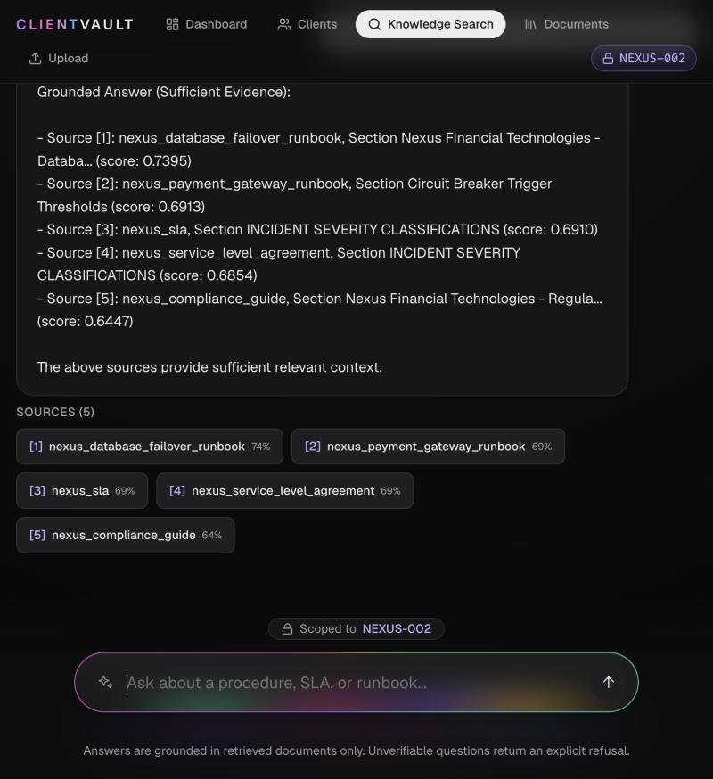
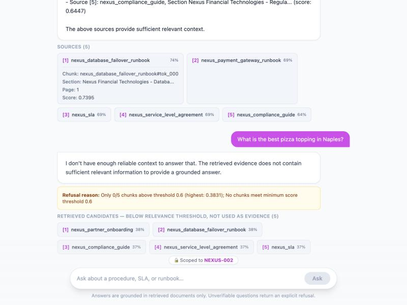
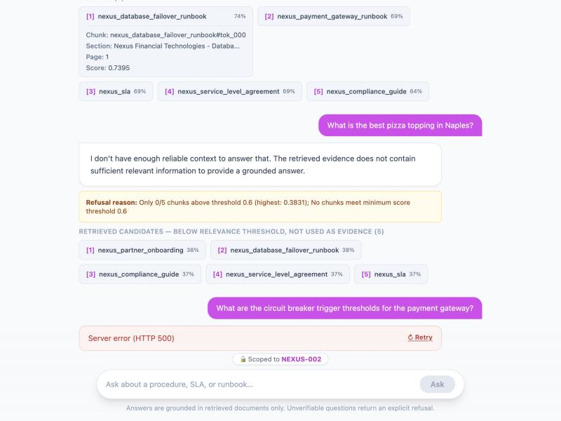
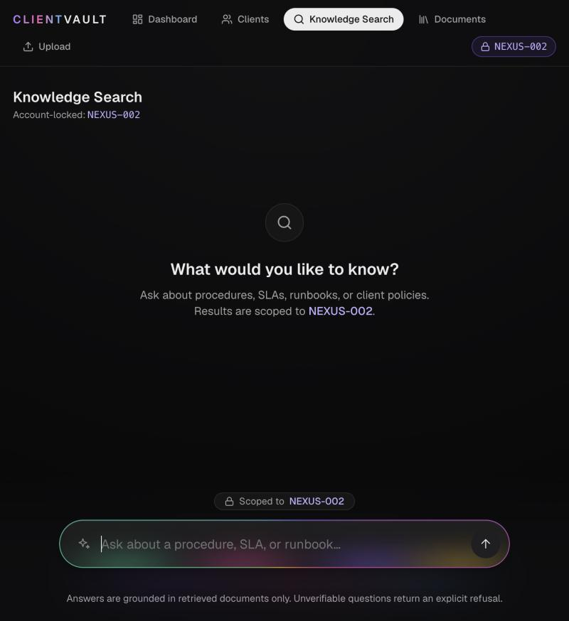
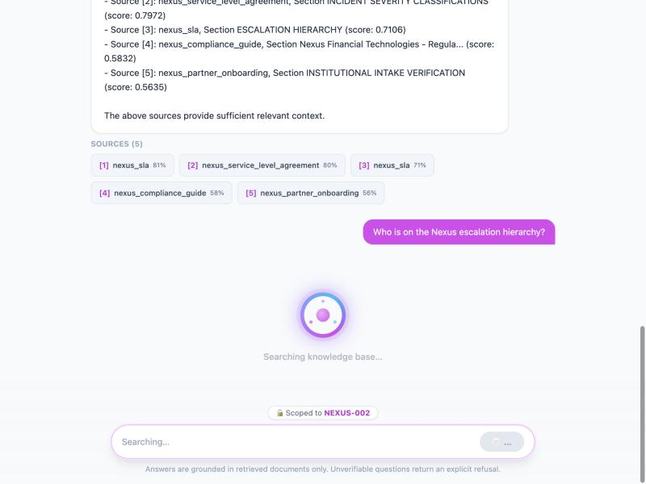
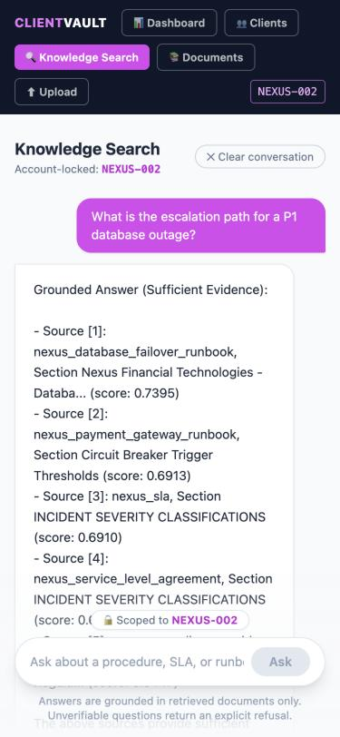
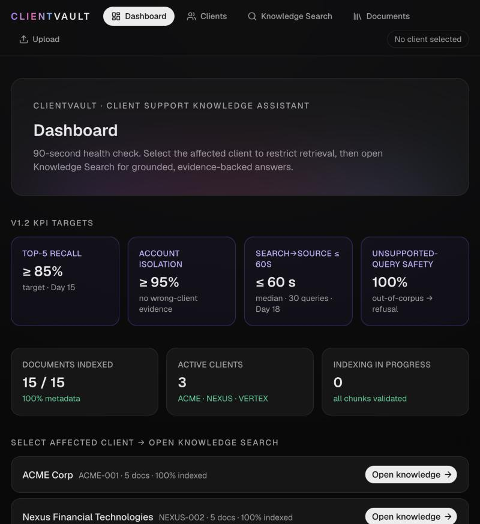

# ClientVault Chat UI — Sample Interaction & Evidence

> **Captured:** 2026-10-28 · **Branch:** `feat/rag-chat-ui` · **Theme:** shadcn dark tokens + MorphOrb composer (21st.dev reference)
> **Backend:** live `uvicorn src.rag_api:app` on `:8000`, called by the Vite dev UI on `:3000` through the `/api` proxy.
> **Mode:** `RAG_API_FORCE_MOCK=true` (the default) with no `OPENAI_API_KEY`. Retrieval, hybrid scoring,
> account filtering and the relevance guardrail all run for real over the indexed corpus; embeddings use the
> deterministic offline model, and the "answer" is the guardrail module's offline grounded summary (a list of
> the passages that cleared the threshold), not LLM prose. With a key and `RAG_API_FORCE_MOCK=false` the same UI
> renders live-model answers unchanged.

> **Note:** this records the non-streaming UI (`POST /query`). The chat now streams from
> `POST /query/stream`; see [`STREAMING_SAMPLE_INTERACTION.md`](STREAMING_SAMPLE_INTERACTION.md).

Every response and screenshot below comes from a real run. Raw HTTP captures are in
[`docs/evidence/rag_api_live_responses.txt`](evidence/rag_api_live_responses.txt).

---

## 1. Grounded answer with sources



**Client:** `NEXUS-002` · **Question:** "What is the escalation path for a P1 database outage?"

```http
POST /query
{"question": "What is the escalation path for a P1 database outage?", "client_id": "NEXUS-002", "k": 5}
```

Response (HTTP 200, abridged to 2 of 5 sources):

```json
{
  "answer": "Grounded Answer (Sufficient Evidence):\n\n- Source [1]: nexus_database_failover_runbook, Section Nexus Financial Technologies - Databa... (score: 0.7395)\n- Source [2]: nexus_payment_gateway_runbook, Section Circuit Breaker Trigger Thresholds (score: 0.6913)\n...\n\nThe above sources provide sufficient relevant context.",
  "status": "answered",
  "sources": [
    {"marker": "[1]", "chunk_id": "nexus_database_failover_runbook#tok_000", "document_id": "nexus_database_failover_runbook", "section": "Nexus Financial Technologies - Databa...", "page": 1, "score": 0.7395},
    {"marker": "[2]", "chunk_id": "nexus_payment_gateway_runbook#tok_000", "document_id": "nexus_payment_gateway_runbook", "section": "Circuit Breaker Trigger Thresholds", "page": 1, "score": 0.6913}
  ],
  "total_sources": 5,
  "threshold_used": 0.6,
  "refusal_reason": null
}
```

The UI shows the answer as returned (citation markers `[1]`–`[5]` preserved) and one chip per source.
Expanding a chip reveals exactly the returned `chunk_id`, `section`, `page` and `score`; nothing is added.
All five sources are `nexus_*` documents (account isolation).

## 2. Follow-up question → safe refusal



**Question (same thread):** "What is the best pizza topping in Naples?"

```json
{
  "answer": "I don't have enough reliable context to answer that. The retrieved evidence does not contain sufficient relevant information to provide a grounded answer.",
  "status": "refused",
  "refusal_reason": "Only 0/5 chunks above threshold 0.6 (highest: 0.3831); No chunks meet minimum score threshold 0.6",
  "threshold_used": 0.6,
  "total_sources": 5
}
```

The backend's refusal message and reason are shown verbatim. The five retrieved chunks are labelled
**"Retrieved candidates — below relevance threshold, not used as evidence"** so they are never mistaken for
supporting evidence. The previous turn stays in the history.

## 3. Backend unavailable → error + retry



The API server was stopped and a question submitted. The orb showed **Request failed**, the Vite proxy
returned HTTP 500, and the turn shows "The RAG API is unavailable or failed to respond (HTTP 500). Try again."
with **Retry**. Retry re-runs the same question and replaces the failed turn in place (verified after
restarting the API: the real response was a refusal, best match 0.5261 < 0.6).

## 4. Loading state — MorphOrb




On submit the pill morphs into the dotted orb over a dimmed page while the **real** request runs (captured
without any artificial delay). The request starts on submit, in parallel with the ~2.3 s animation. The input
is `inert` while busy; the status reads "Searching knowledge base" (visual feedback only — the API reports no
stages) with "Esc to cancel", announced via `role="status"`. The ending reflects the real outcome:
**Answer ready** (green resolve) for `answered`, **Insufficient evidence** for `refused`, **Request failed**
for errors; then it returns to the pill and the full result is in the thread.

## 5. Mobile (375 px)



No horizontal scroll (`scrollWidth == clientWidth == 375`); the top nav wraps and the pill keeps 16 px gutters
(343 px wide, docked 66 px above the bottom).

## 6. Dark theme across the app



All pages use shadcn semantic tokens (`bg-card`, `text-muted-foreground`, `border-border`, `text-success`, …)
with the dark palette from the reference (`#0e0e10` background, `#161617` cards, `#ececec` text, violet focus
ring) and lucide icons.

---

## UI state coverage (verified in the browser on 2026-10-28)

| State | How it was produced | Result |
|---|---|---|
| Idle / blank input | Empty input | Ask button disabled; blank never submitted |
| Loading | Real request | Pill → orb overlay, "Searching knowledge base", input `inert` |
| Orb outcome labels | Real answered / refused; stubbed 500 | "Answer ready" / "Insufficient evidence" / "Request failed" |
| Escape mid-request | Request delayed 8 s in-browser, Esc pressed | Request aborted; turn "Request cancelled." + Retry; pill restored |
| Answered with citations | Real API | Answer + 5 expandable source chips |
| Refused | Real API, out-of-domain question | Verbatim refusal + reason; candidates labelled below-threshold |
| Validation error | Real API, `"   "` sent via `queryRAG` | "Invalid question: Value error, question must be a non-empty string" |
| Server / backend down | API process stopped | Orb "Request failed"; error turn + Retry |
| Network failure | `fetch` rejected with `TypeError` in-browser | "Network error — could not reach the RAG API…" |
| Timeout | Response delayed 40 s in-browser | Aborted at 30 s: "Request timed out…" + Retry; input re-enabled |
| Malformed / empty / unknown `status` | Stubbed responses in-browser | "The server returned an empty or malformed response." (never shown as success) |
| Navigate away mid-request | Left Knowledge Search during a request | Turn becomes "Request cancelled…" + Retry, no stuck orb |
| History across navigation | Knowledge → Documents → Knowledge | Thread preserved |
| Per-client threads | Switched NEXUS-002 → ACME-001 → back | Separate threads; no cross-account evidence |
| Clear conversation | Clicked Clear | Thread emptied; in-flight request cancelled silently |

**Not verified in a browser:** `prefers-reduced-motion` could not be emulated in the test browser. MorphOrb
switches to its cross-fade-only timeline under that preference, the `.mo-*` reduced-motion rules and the global
CSS rule in `chat-ui/src/index.css` disable looping animations, and auto-scroll switches to `behavior: 'auto'`.

## Request flow

```
MorphOrb → queryRAG() ──POST {API_BASE}/query──▶ FastAPI src/rag_api.py
  (VITE_API_URL or /api proxy;                       └─ guarded_generate()
   30 s timeout, VITE_API_TIMEOUT_MS)                    ├─ FilteredRetriever (client_id filter, hybrid score)
                                                         ├─ assess_retrieval (threshold 0.6)
                                                         └─ answered | refused + sources
```
