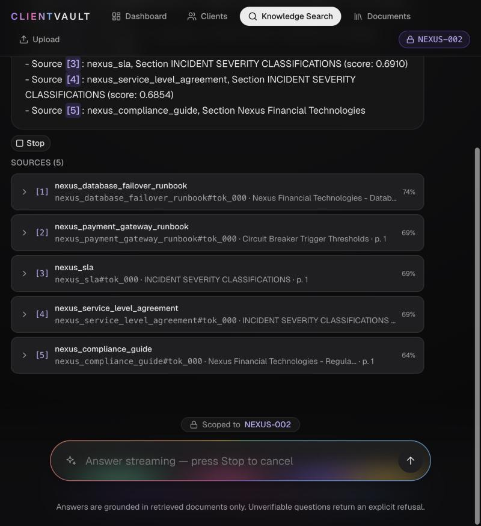
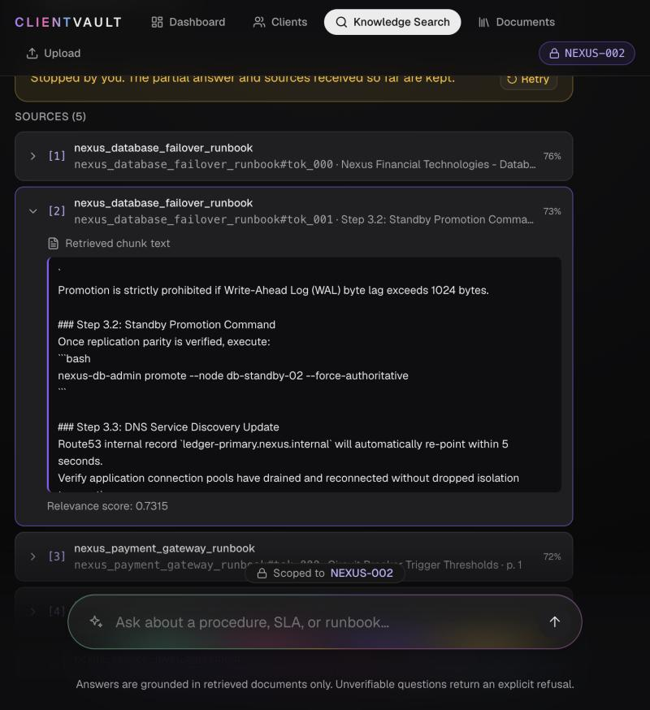
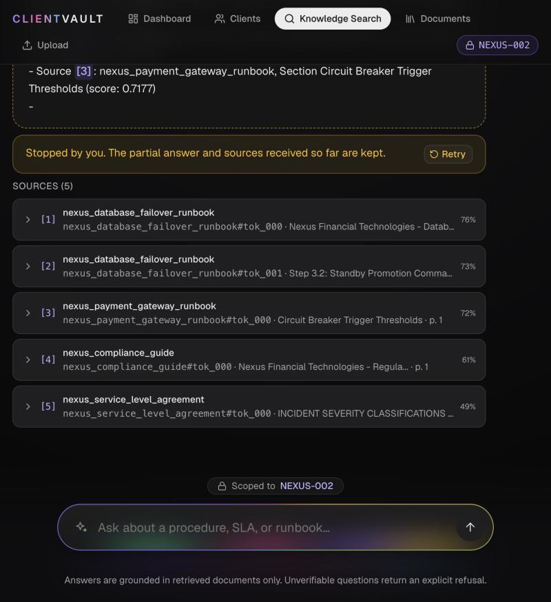
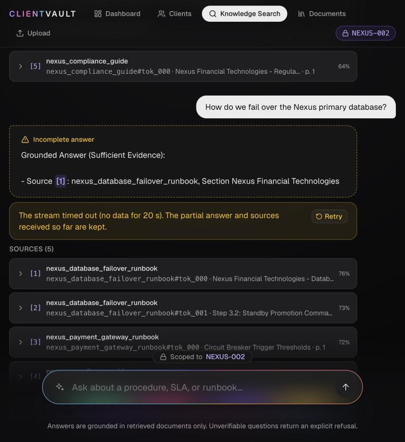

# Streaming Responses & Citation Display — Sample Interaction

> **Captured:** 2026-10-28 · **Branch:** `feat/streaming-citations`
> **Backend:** live `uvicorn src.rag_api:app` (`POST /query/stream`), UI via the Vite `/api` proxy.
> **Mode:** offline (`RAG_API_FORCE_MOCK=true`, no `OPENAI_API_KEY`). Retrieval, account filtering and the
> relevance guardrail run for real; the answer text is the guardrail's grounded summary (the same text
> `POST /query` returns), emitted word by word with `RAG_API_STREAM_DELAY_MS=40`. With an API key and
> `RAG_API_FORCE_MOCK=false`, tokens are forwarded from the model's own stream instead (`mode: "live"`).

Raw, timestamped stream: [`docs/evidence/stream_recording.txt`](evidence/stream_recording.txt).

---

## Event protocol (`POST /query/stream`, `text/event-stream`)

Same request body as `POST /query` (`question`, optional `client_id`, `k`); validation errors are still `422`.

| Event | When | Payload |
|---|---|---|
| `citations` | retrieval passed the guardrail | `sources[]`: `marker`, `chunk_id`, `document_id`, `section`, `page`, `score`, **`text`** (full chunk) |
| `token` | for each piece of answer text | `text` |
| `refusal` | guardrail rejected the evidence | `message`, `reason`, `threshold`, `candidates[]` |
| `done` | stream finished cleanly | `status`: `answered` \| `refused`; `mode`: `live` \| `offline` |
| `error` | exception before/while streaming | `message` (generic; details only in server logs) |

A stream that ends **without `done`** is treated by the UI as interrupted.

## 1. Progressive streaming — recorded output

`What is the escalation path for a P1 database outage?` (client `NEXUS-002`), arrival time at the client:

```text
+    102 ms  {"type": "citations", "sources": [{"marker": "[1]", "chunk_id": "nexus_database_failover_runbook#tok_000", ...}]}
+    148 ms  {"type": "token", "text": "Grounded "}
+    193 ms  {"type": "token", "text": "Answer "}
+    238 ms  {"type": "token", "text": "(Sufficient "}
+    283 ms  {"type": "token", "text": "Evidence):\n\n"}
   … 66 token events in total …
+   3017 ms  {"type": "token", "text": "relevant "}
+   3062 ms  {"type": "token", "text": "context."}
+   3062 ms  {"type": "done", "status": "answered", "mode": "offline"}
```

Citations arrive first (102 ms), so sources are visible before the answer finishes. In the browser the
answer card grew 95 → 166 → 265 → 348 → 451 → 546 → 600 characters over ~3 s (sampled every ~450 ms),
with `aria-busy="true"` until `done`.



Mid-stream: partial answer with linked `[n]` markers, **Stop** button, all five citations already listed, and
the composer locked ("Answer streaming — press Stop to cancel"). (This frame is from a Retry, which streams
straight into the thread; a new question first plays the short orb intro, which hands over as soon as the
first event arrives.)

## 2. Citations linked to source content



Each source card always shows its marker, document, chunk ID, section and page, and score. Clicking `[2]`
in the answer opened and focused card [2] and revealed the retrieved chunk text exactly as the API sent it
(here the `Step 3.2: Standby Promotion Command` passage of `nexus_database_failover_runbook`). Markers that
do not match a returned source are left as plain text, never linked.

## 3. Interruptions and errors



**Stopped by the user** mid-stream: the partial text is kept with an *Incomplete answer* badge and dashed
border, citations are kept, and Retry re-runs the question in place.



**Backend killed mid-stream** (`kill -9` on the API process; for this test only the API ran with
`RAG_API_STREAM_DELAY_MS=300` so the kill could land mid-answer). The Vite dev proxy kept the browser
connection open, so no disconnect reached the page; the **20 s idle timeout** (`VITE_STREAM_IDLE_TIMEOUT_MS`)
aborted the stream and the turn became *Incomplete* with "The stream timed out (no data for 20 s)", partial
text and citations kept. After restarting the API, Retry completed the answer (624 characters, 5 sources).

| Case | How it was produced | Result in the UI |
|---|---|---|
| Normal answer | Real API | citations → growing answer with caret → "Answer complete with 5 sources." |
| Refusal | Real API, out-of-domain question | `refusal` → backend message + reason verbatim; candidates labelled below-threshold, text viewable |
| User stop / Escape | Stop button mid-stream | *Incomplete*, "Stopped by you.", Retry |
| Server `error` event mid-stream | Transport stubbed in-browser with the backend's exact error event | *Incomplete*, "The answer stopped streaming. Please retry.", 1 citation + linked `[1]` kept |
| Backend killed mid-stream | `kill -9` on the API | idle timeout → *Incomplete* + Retry; Retry succeeded after restart |
| Backend down before start | API stopped | HTTP 500 from proxy → error turn + Retry (no fabricated answer) |
| Malformed / non-JSON event | Parser checks (in-browser, real module) | `MalformedStreamError` → error/incomplete, never success |
| Stream ends without `done` | covered by the same path | *Incomplete*, "The answer stream ended before completing." |
| Events split across network reads | Parser fed one byte at a time (incl. CRLF, comments, multi-line `data:`, `é`/`🌍`) | identical events to an unsplit stream |
| New question while streaming | Composer submit | blocked (shake); placeholder explains Stop |
| Mobile 375 px | Viewport emulation | no horizontal overflow |

Server-side, `tests/test_rag_stream.py` (8 tests) covers event order, streamed text == `/query` answer,
citation text + markers + account isolation, refusal, 422, mid-stream failure (`citations, token, error` and
no `done`, no internal detail leaked), failure before retrieval, and live-mode forwarding of model deltas
(with a fake OpenAI stream — **not** run against a real model, since no key is configured).

## Accessibility

Streaming tokens are not announced one by one: the answer card is `aria-busy` while streaming and a separate
polite status region announces only state changes ("5 sources retrieved. Answer streaming." →
"Answer complete with 5 sources." / "Answer interrupted. …" / "Refused: insufficient evidence."). Citation
markers and source cards are buttons with `aria-expanded` / `aria-controls`; Stop and Retry are keyboard
reachable.

## Capture notes

The in-app browser pane used for verification throttled timers and painting, so a few frames had to be
retaken; the orb overlay could not be captured mid-flight there (state was verified from the DOM instead).
`prefers-reduced-motion` was not emulated.
